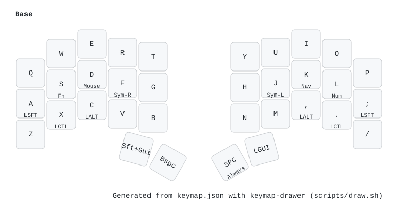
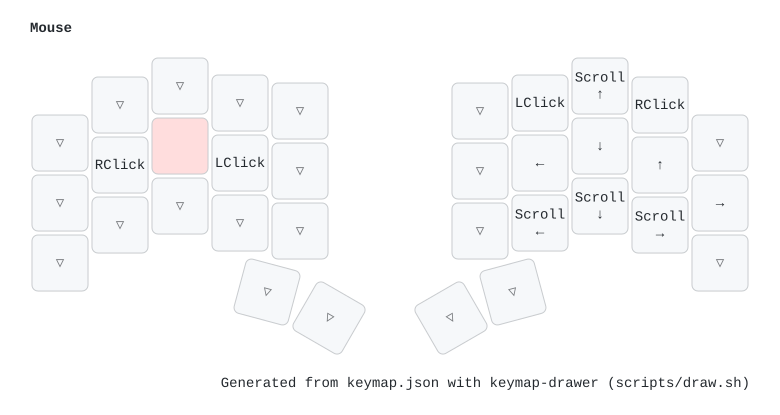
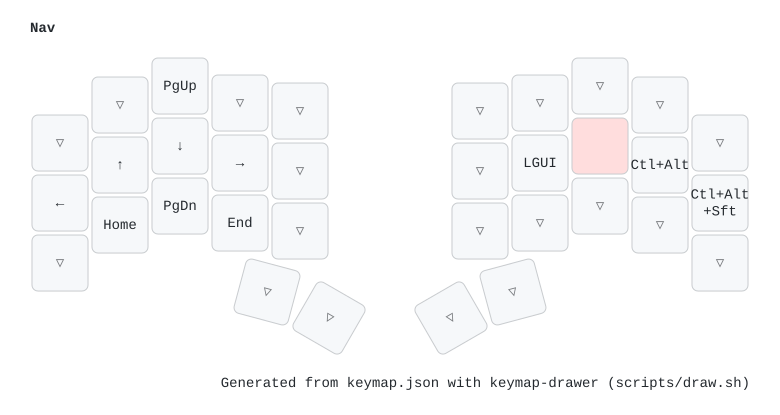
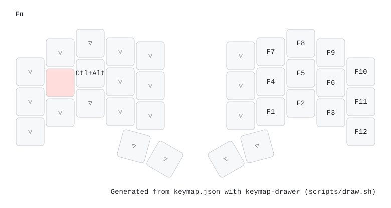
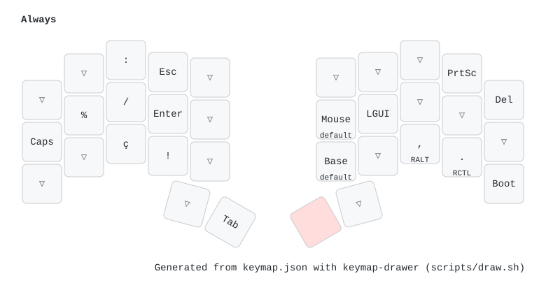

# Ferris Sweep – QMK keymap

My Ferris Sweep (34 keys, Pro Micro) QMK keymap. It started as a copy of the
[ferris default keymap](https://github.com/qmk/qmk_firmware/tree/master/keyboards/ferris/keymaps/default)
with small changes (i3wm shortcuts, PrintScreen, `ç`, …).

| Path | What |
| --- | --- |
| `keymap.json` | The keymap (QMK Configurator format, no `keymap.c` needed) |
| `config.h` | Tapping term, home-row-mod settings, mouse key speeds |
| `img/` | Layer images (generated) |
| `scripts/draw.sh` | Regenerates `img/` |
| `scripts/keymap_drawer.yaml` | Key labels used by `draw.sh` |

## Flashing

Notes for next time. QMK builds the firmware on this machine and flashes it over USB.

### How the halves work

The USB cable goes into the **left** half, and the TRRS cable connects the two
halves. Each half has its own Pro Micro, but only the left one runs the keymap.
The right one just reports which keys are pressed over the TRRS cable.

So **a keymap change only needs flashing the left half**, through the usual USB
cable. The right half's Pro Micro also has a USB port, but you only need it if
the right half ever needs new firmware (see the last section).

### Steps

1. **QMK checkout**. `~/.config/qmk/qmk.ini` points at `~/workspace/qmk_firmware`
   and sets the defaults `keyboard = ferris/sweep` and `keymap = sid`. If the
   checkout is missing:
   ```sh
   qmk setup          # clones qmk_firmware to the qmk_home path in qmk.ini
   ```
2. **Put this repo in QMK's tree as the `sid` keymap**. QMK only builds keymaps
   inside `qmk_firmware`:
   ```sh
   ln -s ~/workspace/ferris-sweep-qmk ~/workspace/qmk_firmware/keyboards/ferris/keymaps/sid
   ```
3. **Build and flash**. Thanks to the qmk.ini defaults, plain `qmk flash` is enough:
   ```sh
   qmk flash          # = qmk flash -kb ferris/sweep -km sid
   ```
4. When it says it's waiting for the bootloader, put the left half in bootloader
   mode. It stays there for ~8 seconds. Any of these works:
   - hold `Space` and press `/` (`QK_BOOT`, on the *Always* layer)
   - short the RST and GND pads (tap twice if once doesn't work)
   - hold `Q` while plugging in the USB cable

The `keyboard`/`keymap` fields inside `keymap.json` (`ferris/0_1`, `default`)
are leftovers from the QMK Configurator export. They're ignored when building
this way.

### If the build fails on current QMK

This keymap was written for an older QMK. Newer versions renamed some keycodes,
and building with a fresh checkout (checked in Nov 2026) fails until you rename them:

| Old (in `keymap.json`) | New |
| --- | --- |
| `KC_BTN1`, `KC_BTN2` | `MS_BTN1`, `MS_BTN2` |
| `KC_MS_L`, `KC_MS_D`, `KC_MS_U`, `KC_MS_R` | `MS_LEFT`, `MS_DOWN`, `MS_UP`, `MS_RGHT` |
| `KC_WH_U`, `KC_WH_D`, `KC_WH_L`, `KC_WH_R` | `MS_WHLU`, `MS_WHLD`, `MS_WHLL`, `MS_WHLR` |
| `RGB_MOD`, `RGB_RMOD` | `UG_NEXT`, `UG_PREV` (no LEDs on this board, so they do nothing anyway) |

With those renamed, it builds (19650/28672 bytes). Check `qmk compile` first.

If you flash a much newer QMK, the right half is still on the old one. The two
halves talk over a serial protocol that can change between QMK versions. If the
right half stops working, flash it too: unplug the TRRS cable, plug the USB
cable into the right half's Pro Micro, run `qmk flash`, and hold `P` (instead
of `Q`) while plugging in.

## Layers

Hold-tap keys show the tap on top and the hold underneath. Red keys are the
ones held to reach the layer. `▽` is transparent (falls through to the layer below).

### 0 – Base


### 1 – Mouse (hold `D`)


### 2 – Navigation (hold `K`)


### 3 – Right symbols (hold `F`)


### 4 – Left symbols (hold `J`)


### 5 – Function keys (hold `S`)


### 6 – Numbers (hold `L`)


### 7 – Always accessible (hold `Space`)


All layers in one image: [img/keymap.svg](img/keymap.svg).

### Regenerating the images

The images are generated with [keymap-drawer](https://github.com/caksoylar/keymap-drawer).
Rerun this after editing `keymap.json`:

```sh
pipx install keymap-drawer   # once
scripts/draw.sh
```

Custom key labels live in `scripts/keymap_drawer.yaml`.
